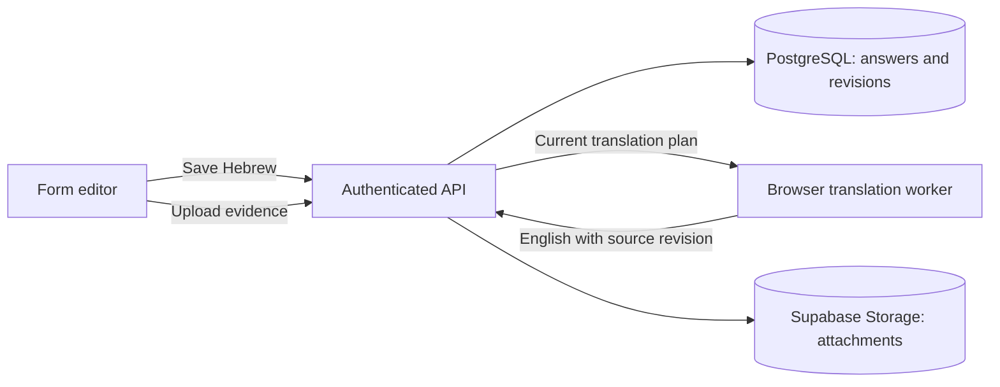

# מפת הפרויקט

[חזרה לעמוד הראשי](../README.md) · [עריכה לפי משימה](editing-guide.md)

האתר מורכב מממשק בדפדפן, שרת ששומר ובודק הרשאות, מסד תשובות ואחסון קבצים. React מצייר את המסכים ו־Next.js מפעיל את השרת ב־Vercel. פונקציית שרת מוגנת ב־Supabase מחברת למסד PostgreSQL ולאחסון הקבצים. Vite משמש לבניית רכיב התרגום המקומי בלבד.

## איפה נמצא כל חלק?

| מיקום | תפקיד | מתי פותחים אותו? |
| --- | --- | --- |
| [app](../app) | עמודים ונתיבי בקשות לשרת | הוספת עמוד או שינוי פעולת API |
| [components/racing](../components/racing) | מסכי הטפסים, הרכז והמסמכים | שינוי חוויית העבודה |
| [components/ui](../components/ui) | רכיבי ממשק משותפים | שינוי רכיב שמשמש בכמה מסכים |
| [lib](../lib) | שמירה, הרשאות, תרגום, ייבוא וייצוא | שינוי התנהגות המערכת |
| [data](../data) | הגדרות טפסים, מיפויי תאים ומקורות | שינוי מבנה שאלה או תבנית; אין כאן תשובות משתמשים |
| [db](../db) | הגדרת SQLite היסטורית לצורכי תאימות | אין זה החיבור למסד הענן הפעיל |
| [hooks](../hooks) | התנהגות ממשק משותפת, כגון זיהוי מסך צר | התאמת התצוגה למכשיר |
| [vendor](../vendor) | קובצי צד שלישי ורישיונותיהם | תחזוקת רכיבים שסופקו עם הפרויקט |
| [drizzle](../drizzle) | סכימת SQLite היסטורית שמשמשת גם בדיקות | בדיקות תאימות; סכימת הענן נמצאת ב־supabase/migrations |
| [supabase](../supabase) | מבנה המסד ופונקציית האחסון | שינוי אחסון משותף והרשאות שרת |
| [worker](../worker) | תצורת Cloudflare היסטורית | שחזור גרסה ישנה בלבד |
| [public](../public) | קבצים סטטיים כמו לוגו | עדכון נכס ציבורי |
| [scripts](../scripts) | הכנת תבניות, קטלוג וסביבת פיתוח | תחזוקת פקודות ההכנה; הפקודות הנתמכות מוגדרות ב־package.json |
| [tests](../tests) | בדיקות התנהגות ונתונים | אימות שמירה, הרשאות, תרגום או ייצוא |
| [.github](../.github) | בדיקות GitHub ותבנית בקשת שינוי | שינוי תהליך העבודה במאגר |
| [docs](.) | המדריכים בעברית | התחלה, פיתוח, תחזוקה ופרסום |
| [private-data](../private-data) | גופן ורישיונו, לצד קלט מקומי שנוצר בהכנה | בירור קלט הבנייה; התבניות והתמונות שנוצרות כאן מוחרגות מ־Git |

## מה קורה כשמסיימים לערוך תיבה?

העורך שומר עברית דרך השרת. לאחר השמירה, הדפדפן מתרגם את הגרסה שנשמרה ושולח אנגלית לשרת. השרת מקבל את התרגום רק אם הוא עדיין מתאים לאותה גרסת מקור. עריכה חדשה אינה נדרסת על ידי תרגום ישן.

## מקור, תוצר שנוצר, ונתונים חיים

| סוג | דוגמה | איך מטפלים בו? |
| --- | --- | --- |
| קוד והגדרות מקור | `data/systems.normalized.json` | עורכים דרך ענף ובקשת שינוי |
| תוצר קטלוג אוטומטי | `data/systems.overview.json` | יוצרים עם `npm run catalog:generate`; שומרים גם אותו ב־Git |
| קובצי בנייה | `dist`, `public/translation` | נוצרים בבנייה; אינם נשמרים ב־Git |
| תבניות שהורדו | `private-data/official-workbook-templates.json` | נוצרות עם `npm run templates:prepare`; המקור והחתימה מתועדים ב־data |
| תשובות, משתמשים והיסטוריה | PostgreSQL פרטי ב־Supabase | מנוהלים באתר; אינם קובצי קוד |
| קבצים שהקבוצה העלתה | Supabase Storage פרטי | מועברים ומגובים בנפרד מהמאגר |

## קובצי תצורה בשורש

| קובץ | תפקיד |
| --- | --- |
| [package.json](../package.json) | פקודות ההפעלה ורשימת החבילות |
| [package-lock.json](../package-lock.json) | גרסאות התקנה מדויקות; מתעדכן עם שינוי תלויות |
| [next.config.ts](../next.config.ts) | הגדרות שרת Next.js |
| [vercel.json](../vercel.json) | פקודות ההתקנה והבנייה לפרסום |
| [vite.config.ts](../vite.config.ts) | תצורת Cloudflare היסטורית, שאינה מופעלת בבנייה הנוכחית |
| [vite.translation.config.ts](../vite.translation.config.ts) | בניית מנוע התרגום לדפדפן |
| [wrangler.jsonc](../wrangler.jsonc) | משאבי Cloudflare היסטוריים; אינם נדרשים לפריסה הנוכחית |
| [.gitignore](../.gitignore) | מה נשאר במחשב ולא נכנס למאגר |

שם היסטורי אחד עדיין קיים: `app/chatgpt-auth.ts`. הוא קורא כיום את עוגיית הרכז שנחתמת ב־`lib/owner-session.ts`; אין תלות בחשבון ChatGPT. כניסת הצוות נבדקת ב־`lib/team-entry.ts`, והחיבור לנתונים ב־`lib/cloud-storage.ts`. קבצי Cloudflare נשמרו לצורך שחזור היסטורי בלבד.

