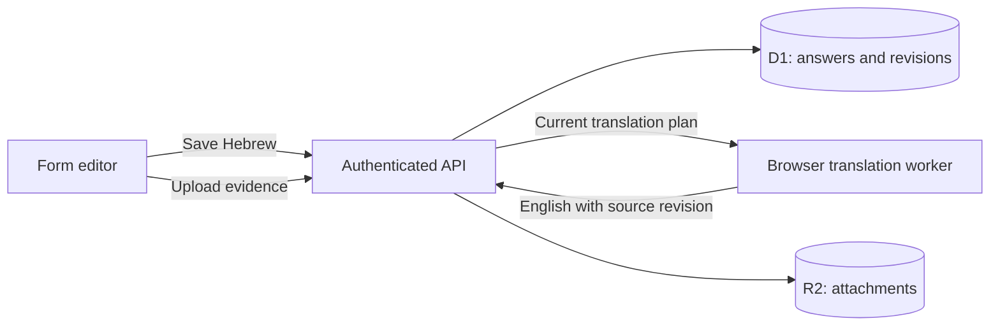

# מפת הפרויקט

[חזרה לעמוד הראשי](../README.md) · [עריכה לפי משימה](editing-guide.md)

האתר מורכב מממשק בדפדפן, שרת ששומר ובודק הרשאות, מסד תשובות ואחסון קבצים. React מצייר את המסכים; Vinext ו־Vite בונים את האפליקציה להרצה ב־Cloudflare Workers. מבנה הנתיבים תואם למוסכמות Next.js.

## איפה נמצא כל חלק?

| מיקום | תפקיד | מתי פותחים אותו? |
| --- | --- | --- |
| [app](../app) | עמודים ונתיבי בקשות לשרת | הוספת עמוד או שינוי פעולת API |
| [components/racing](../components/racing) | מסכי הטפסים, הרכז והמסמכים | שינוי חוויית העבודה |
| [components/ui](../components/ui) | רכיבי ממשק משותפים | שינוי רכיב שמשמש בכמה מסכים |
| [lib](../lib) | שמירה, הרשאות, תרגום, ייבוא וייצוא | שינוי התנהגות המערכת |
| [data](../data) | הגדרות טפסים, מיפויי תאים ומקורות | שינוי מבנה שאלה או תבנית; אין כאן תשובות משתמשים |
| [drizzle](../drizzle) | מיגרציות: שינויים מתועדים במבנה המסד | הוספת טבלה או עמודה |
| [worker](../worker) | הכניסה לשרת ואימות גישה | טיפול באבטחה ובהרצה |
| [public](../public) | קבצים סטטיים כמו לוגו | עדכון נכס ציבורי |
| [scripts](../scripts) | הכנת תבניות, קטלוג וסביבת פיתוח | תחזוקת פקודות ההכנה; הפקודות הנתמכות מוגדרות ב־package.json |
| [tests](../tests) | בדיקות התנהגות ונתונים | אימות שמירה, הרשאות, תרגום או ייצוא |
| [.github](../.github) | בדיקות GitHub ותבנית בקשת שינוי | שינוי תהליך העבודה במאגר |
| [docs](.) | המדריכים בעברית | התחלה, פיתוח, תחזוקה ופרסום |
| [private-data](../private-data) | גופן ורישיונו, לצד קלט מקומי שנוצר בהכנה | בירור קלט הבנייה; התבניות והתמונות שנוצרות כאן מוחרגות מ־Git |

## מה קורה כשמסיימים לערוך תיבה?

העורך שומר עברית דרך השרת. לאחר השמירה, הדפדפן מתרגם את הגרסה שנשמרה ושולח אנגלית לשרת. השרת מקבל את התרגום רק אם הוא עדיין מתאים לאותה גרסת מקור. עריכה חדשה אינה נדרסת על ידי תרגום ישן.

## מקור, תוצר שנוצר, ונתונים חיים

| סוג | דוגמה | איך מטפלים בו? |
| --- | --- | --- |
| קוד והגדרות מקור | `data/systems.normalized.json` | עורכים דרך ענף ובקשת שינוי |
| תוצר קטלוג אוטומטי | `data/systems.overview.json` | יוצרים עם `npm run catalog:generate`; שומרים גם אותו ב־Git |
| קובצי בנייה | `dist`, `public/translation` | נוצרים בבנייה; אינם נשמרים ב־Git |
| תבניות שהורדו | `private-data/official-workbook-templates.json` | נוצרות עם `npm run templates:prepare`; המקור והחתימה מתועדים ב־data |
| תשובות, משתמשים והיסטוריה | מסד D1 | מנוהלים באתר; אינם קובצי קוד |
| קבצים שהקבוצה העלתה | אחסון R2 | מועברים ומגובים בנפרד מהמאגר |

## קובצי תצורה בשורש

| קובץ | תפקיד |
| --- | --- |
| [package.json](../package.json) | פקודות ההפעלה ורשימת החבילות |
| [package-lock.json](../package-lock.json) | גרסאות התקנה מדויקות; מתעדכן עם שינוי תלויות |
| [vite.config.ts](../vite.config.ts) | בניית האתר ושרת הפיתוח |
| [vite.translation.config.ts](../vite.translation.config.ts) | בניית מנוע התרגום לדפדפן |
| [wrangler.jsonc](../wrangler.jsonc) | שמות משאבי Cloudflare; מזהה המסד במאגר הוא מציין מקום |
| [.gitignore](../.gitignore) | מה נשאר במחשב ולא נכנס למאגר |

שם היסטורי אחד עדיין קיים: `app/chatgpt-auth.ts`. הוא מספק כיום אימות Cloudflare Access או זהות פיתוח מקומית. שם הקובץ אינו תלות בחשבון ChatGPT; אימות הבקשות נעשה ב־`worker/index.ts` וב־`lib/access-identity.ts`.

